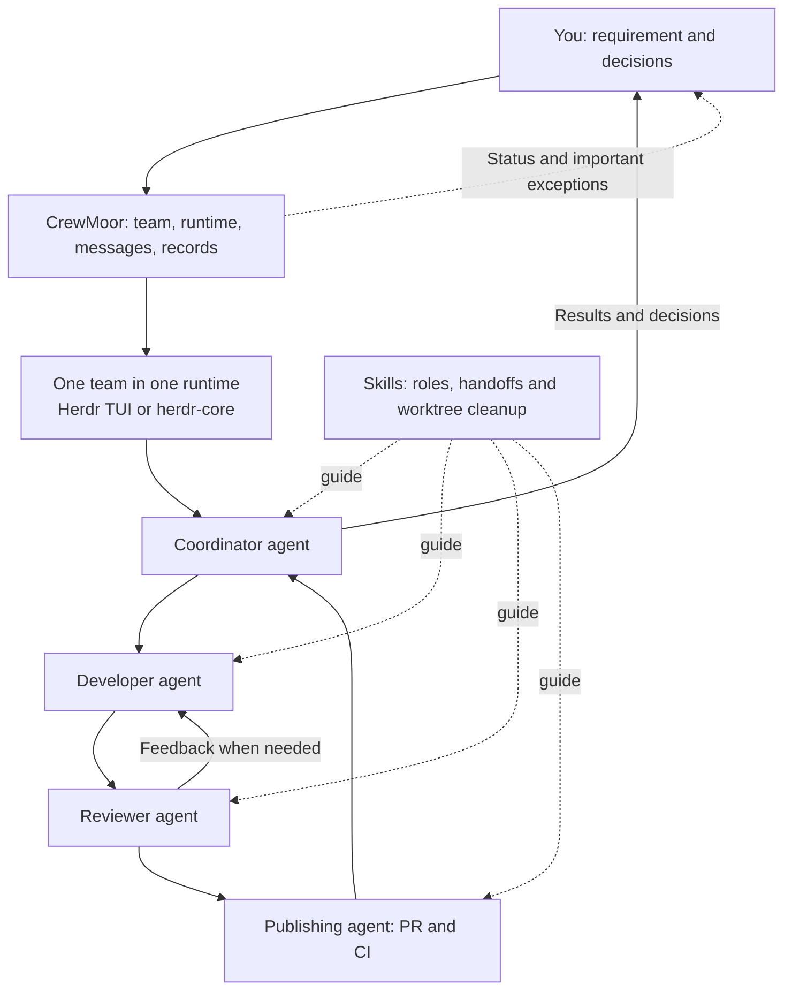

# CrewMoor

A lightweight workspace for coordinating AI agents across different runtime environments.

> **Project status: launch prototype under validation.** Issue #2 supports explicit Codex/Claude selection and TUI/core launch, process location and owned cleanup. It does not infer Agent ready/working/done state; Agent feedback is a separate issue. Historical real core/Codex and App observations exist; the revised entrypoints still need audited real launch/cleanup evidence. See [usage and limits](docs/runtime-launch.md) and [evidence](docs/issue-2-runtime-evidence.md). The broader workflow below remains the intended direction.

CrewMoor is for an everyday development loop: give a small team a requirement, let its agents develop and review the change, follow the pull request and CI, and see what needs your attention.

## How a day might look

1. You give a project team a requirement and its constraints.
2. A coordinating agent works with a developer, a reviewer, and a publishing agent. Their roles, handoffs, and responsibilities are described in skills.
3. The team develops, reviews, handles the PR and CI, and reports results. Agents manage and clean up their own temporary worktrees.
4. You can check the team's reported progress and running state. The team asks for your decision when needed.

This is an example of the intended workflow, not a fixed pipeline. Tasks and roles can differ between teams.

## What CrewMoor is intended to do

- Configure a team, its roles, agents, models, and runtime.
- Start agents, connect logical roles to their actual runtime sessions, and pass messages.
- Show useful running information alongside the team's own progress reports.
- Keep a small local record of tasks and results using SQLite.
- Stop team-owned runtime resources when appropriate, and notify the user when attention is needed.

A team is bound to **one runtime instance**. Different teams may use different runtimes; CrewMoor does not route a team across runtimes or move an active session between them.

## What stays with the agents

Skills and agents own the development workflow: interpreting requirements, implementing changes, review, PR and CI work, handoffs, and cleaning up their own temporary worktrees. A message being accepted is not proof that the recipient completed the task.

CrewMoor does not need to turn every handoff into a fixed workflow state machine. When an unusual situation cannot be safely determined, it should stop the affected action and ask a person, rather than guess or repeatedly retry.

## Runtime direction

The initial direction is to learn from the existing [herdr-flow-rust](https://github.com/musutrade/herdr-flow-rust) TUI workflow, then support separate integrations for:

- **Herdr TUI**, using its own agent and terminal interfaces.
- **herdr-core**, the runtime behind Herdr App. Agent control should not require an App window; App-specific presentation can be considered separately.

Runtime capabilities and semantics differ. Support for either integration, individual agents, or specific recovery features must be verified rather than assumed. The existing TUI project remains independent and useful; replacement or migration is not a prerequisite.

## Scope

CrewMoor aims to provide the smallest useful foundation for the team's actual workflow. It is not intended to be a general-purpose workflow engine, a cross-runtime session migration service, or a heavy message broker.

Design discussion starts in the repository issues. The first prototype's supported setup and acceptance steps are in [docs/runtime-launch.md](docs/runtime-launch.md).

## Quality gates

Rust 质量门禁的规则、度量定义与验证限制见 [docs/quality-gates.md](docs/quality-gates.md)。
