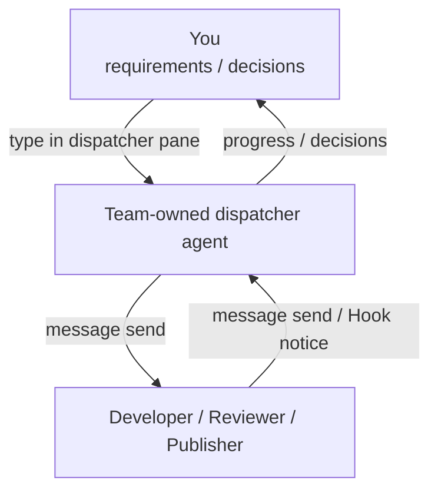

# CrewMoor

A lightweight CLI for coordinating AI agents across runtimes: assign requirements, pass messages, record feedback, and track delivery.

Supports **Herdr TUI** and **Herdr App** (via herdr-core). Orca support planned.

[中文说明](docs/README.zh.md)



## Runtime support

| Runtime | Status |
|---|---|
| Herdr TUI | Supported |
| Herdr App (herdr-core) | Supported |
| Orca | Planned |

A team runs in one runtime instance. Different teams may use different runtimes.

The user works directly in the dispatcher pane created by `team start`. That
dispatcher assigns work and reports results through the fixed worker bindings;
there is one dispatch layer. The launcher hands over the returned team directory
and dispatcher location, then leaves ongoing coordination to that dispatcher.
Existing sessions are not imported into this workflow.

## Subcommands

| Command | Responsibility |
|---|---|
| `crewmoor team` | Start a team, bind workers, track sessions |
| `crewmoor message` | Send messages between dispatcher and workers |
| `crewmoor feedback` | Record Hook events and forward to dispatcher |
| `crewmoor issue` | Assign a GitHub Issue, check completion, fetch next |
| `crewmoor app-target` | Generate an `app-target.toml` from a running herdr-core |

## Quick start

> **Prerequisites**: `gh` (authenticated) installed, plus one of:
> - **Herdr TUI**: `herdr` running
> - **Herdr App**: `hc` (herdr-core) running and connected to Herdr App; an `app-target.toml` pointing at the live socket

### 1. Install

```bash
cargo install --path .
```

### 2. Register the Hook callback

```bash
crewmoor feedback hooks plan claude install REGISTRY BINARY PLAN_DIR
crewmoor feedback hooks apply PLAN_DIR
```

Repeat for each Agent kind used (`claude` or `codex`), preserving existing
handlers and completing any native Hook review. Only registered task instances
are collected; worker Stop / SessionEnd forwarding starts after `team bind`.
See [Hook installation](docs/agent-feedback.md) and the versioned
[crewmoor-team-flow skill](skills/crewmoor-team-flow/SKILL.md).

### 3. Start a team

**Herdr TUI** (`runtime = "tui"`, team config includes `host`):

```bash
crewmoor team start /absolute/team.toml /absolute/state
# Use the returned team_dir; sample-team/worker are from examples/team-tui.toml.
crewmoor team bind /absolute/state/teams/sample-team worker
```

**Herdr App / herdr-core** (`runtime = "core"`, team config includes `app_target`):

```bash
crewmoor team start /absolute/team-core.toml /absolute/state
crewmoor team bind /absolute/state/teams/sample-core-team worker
```

See [`examples/team-core.toml`](examples/team-core.toml) for a core-mode team config template.

Read `roles[]` in the start result: select the role named by the configuration's
`dispatcher`, and open its returned `handle` (TUI pane or core terminal). Enter
requirements and decisions there in ordinary language; the human needs no
separate role or self-binding. The launcher supplies `team_dir`, CLI path and
worker binding paths to that dispatcher. Bind each worker after both native
SessionStart events have established their sessions. If a session or binding
is missing, report it once; do not poll, re-launch or adopt another session.
`accepted` is launch admission, not Agent readiness or task completion.
See the [complete handover chain](docs/team-launch.md).

### 4. Assign and track a requirement

```bash
# Assign Issue #42 to the dispatcher instance
crewmoor issue assign ~/.local/state/crewmoor/feedback musutrade/crewmoor 42 <instance>

# Read current assignment
crewmoor issue current ~/.local/state/crewmoor/feedback <instance>

# Check whether the issue is closed
crewmoor issue done ~/.local/state/crewmoor/feedback <instance>

# Fetch the next open issue (default label: ready)
crewmoor issue next musutrade/crewmoor
crewmoor issue next musutrade/crewmoor --label sprint
```

### 5. Send a message

```bash
# Reuse the pair binding written by team bind; do not bind the pair again.
crewmoor message send /absolute/state/teams/sample-team/roles/worker/binding.json /absolute/request.json
```

The dispatcher authors a flat request such as
`{"id":"request-001","from":"lead","to":"worker","reply_to":null,"content":"Implement the assigned requirement and report the result."}`.
The worker actively replies through the same binding with a new `id`, reversed
roles and `reply_to: "request-001"`. `reply_to` refers to the original message
ID, not a role name. `transport: accepted` means submission only; the authored
reply establishes actual receipt and business progress. Direct `herdr agent
prompt` or `hc send` is the transport implementation, not another business
channel for team members. See [message semantics](docs/messages.md).

### 6. View feedback records

```bash
crewmoor feedback show ~/.local/state/crewmoor/feedback <instance>
```

When the team's work is finished, close only its recorded resources:

```bash
crewmoor team stop /absolute/state/teams/sample-team
```

## Herdr App / herdr-core

For `runtime = "core"` teams, CrewMoor connects to an already-running herdr-core instance through an **app-target file**.

### Generate app-target.toml

```bash
# Print to stdout (review before saving)
crewmoor app-target generate

# Write directly to a file (refuses to overwrite an existing one)
crewmoor app-target generate --output app-target.toml

# Point at a non-default socket
crewmoor app-target generate --socket /run/user/1000/herdr-core/other.sock --output app-target.toml
```

The command reads `server.status` and `doc.get` from the live socket. It fills in `session`, `socket`, `core_id`, and `machine` automatically. Available spaces and tabs are listed as commented-out lines so you can uncomment the one you want; both fields are omitted by default (project placement mode).

Example output:

```toml
# Generated by crewmoor app-target generate (hc 0.1.16)
# Review space_id and tab_id before use; omit both for project placement.
session   = "default"
socket    = "/run/user/1000/herdr-core/default.sock"
core_id   = "4a8f843e64e0a7778943d8a31c25cc26"
machine   = "musutrade"

# Available spaces and tabs (uncomment to use):
# space: myproject
# space_id = "sp-abc"  # myproject
# tab_id   = "tb-def"  # main
```

Once you have the file, point your team config at it:

```toml
# team.toml
app_target = "/path/to/app-target.toml"
```

CrewMoor reads this file, verifies the running core identity, and routes all terminal sends through the existing socket. It never starts or stops the core process.

### One App tab per role

By default every role's terminal gets the `herdr.space` / `herdr.tab` labels from `app-target.toml`, so all roles share one tab. To give a role its own tab, set `tab_id` on that role in `team.toml`. Roles without `tab_id` keep using the `app-target.toml` tab.

```toml
[[roles]]
role = "lead"
tab_id = "tb-lead-tab-id"    # overrides app-target.toml tab_id for this role
# ...

[[roles]]
role = "worker"
tab_id = "tb-worker-tab-id"
# ...
```

Rules:

- Only `runtime = "core"` teams accept a per-role `tab_id`.
- `app-target.toml` must set both `space_id` and `tab_id`; per-role tabs live in that space. Project placement (both omitted) does not support per-role tabs.
- The tab must already exist in the App layout, the same check the team-level `tab_id` gets. A `<machine>/` prefix is accepted and stripped, as for `app-target.toml`.

CrewMoor does not create tabs. Create them in Herdr App first, either from the App interface (the `+` in the tab bar) or with the App's official command, which prints the new tab id:

```bash
herdr-app do tab.new --name lead --space <space_id>
```

`herdr tab create` is a Herdr TUI command and does not create Herdr App tabs.

## Session integrity

CrewMoor records each agent's session ID at bind time (from the agent's own Hook, not inferred from the process). A different native session writes a visible `session-rejected` fact; subsequent normal sends involving that dispatcher or worker are refused, preserving the original binding and association. Stop dispatch to that role and report the change to the user. Do not automatically rebind, restart or recover it. Each rejected worker Hook event may forward one halt notice to an unchanged dispatcher. Multiple rejected events can therefore produce multiple notices; there is no transport deduplication. The dispatcher reports a halt to the user once. The dispatcher's own events stay local: the user is already in its pane, and there is no upstream Agent. View either role's facts with `feedback show`; a turn ending is not business completion.

## No daemon

There is no background process or state machine. Conditional delivery runs inside
the bounded Hook callback. A delivery refused before submission can be considered
on a later Stop; an accepted or unconfirmed submission is marked and not resent.

## Conditional delivery

When the dispatcher agent stops, CrewMoor checks automatically:

1. Is the currently assigned issue closed?
2. Is there a next open issue in the queue (label=ready)?

If both are true, the next issue is sent to the dispatcher once, without resending.

## Quality gates

CRAP ≤ 10, no `unwrap()` in non-test code, zero Clippy exemptions.

```bash
cargo +stable run --locked --manifest-path tools/quality/Cargo.toml -- verify
```

See [docs/quality-gates.md](docs/quality-gates.md) for details.
