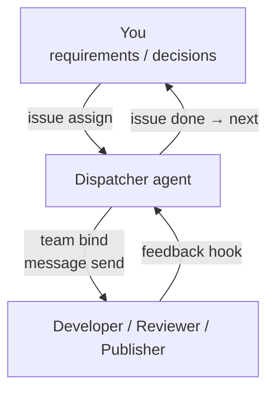

# CrewMoor

A lightweight CLI for coordinating AI agents across runtimes: assign requirements, pass messages, record feedback, and track delivery.

Supports **Herdr TUI** and **Herdr App** (via herdr-core). Orca support planned.

[中文说明](docs/README.zh.md)



## Runtime support

| Runtime | Status |
|---|---|
| Herdr TUI | Supported |
| Herdr App (herdr-core) | Supported |
| Orca | Planned |

A team runs in one runtime instance. Different teams may use different runtimes.

## Subcommands

| Command | Responsibility |
|---|---|
| `crewmoor team` | Start a team, bind workers, track sessions |
| `crewmoor message` | Send messages between dispatcher and workers |
| `crewmoor feedback` | Record Hook events and forward to dispatcher |
| `crewmoor issue` | Assign a GitHub Issue, check completion, fetch next |

## Quick start

> **Prerequisites**: `gh` (authenticated) installed, plus one of:
> - **Herdr TUI**: `herdr` running
> - **Herdr App**: `hc` (herdr-core) running and connected to Herdr App; an `app-target.toml` pointing at the live socket

### 1. Install

```bash
cargo install --path .
```

### 2. Register the Hook callback

```bash
crewmoor feedback hooks plan claude install REGISTRY BINARY PLAN_DIR
crewmoor feedback hooks apply PLAN_DIR
```

After installation, Stop / SessionEnd events from agents are recorded and forwarded to the dispatcher automatically.

### 3. Start a team

**Herdr TUI** (`runtime = "tui"`, team config includes `host`):

```bash
crewmoor team start team.toml ~/.local/state/crewmoor
crewmoor team bind  ~/.local/state/crewmoor/teams/myteam developer
crewmoor team stop  ~/.local/state/crewmoor/teams/myteam
```

**Herdr App / herdr-core** (`runtime = "core"`, team config includes `app_target`):

```bash
crewmoor team start team-core.toml ~/.local/state/crewmoor
crewmoor team bind  ~/.local/state/crewmoor/teams/myteam developer
crewmoor team stop  ~/.local/state/crewmoor/teams/myteam
```

See [`examples/team-core.toml`](examples/team-core.toml) for a core-mode team config template.

### 4. Assign and track a requirement

```bash
# Assign Issue #42 to the dispatcher instance
crewmoor issue assign ~/.local/state/crewmoor/registry musutrade/crewmoor 42 <instance>

# Read current assignment
crewmoor issue current ~/.local/state/crewmoor/registry <instance>

# Check whether the issue is closed
crewmoor issue done ~/.local/state/crewmoor/registry <instance>

# Fetch the next open issue (default label: ready)
crewmoor issue next musutrade/crewmoor
crewmoor issue next musutrade/crewmoor --label sprint
```

### 5. Send a message

```bash
# Bind first (creates the binding file)
crewmoor message bind msg-config.json roles/developer/binding.json

# Then send
crewmoor message send roles/developer/binding.json message.json
```

### 6. View feedback records

```bash
crewmoor feedback show ~/.local/state/crewmoor/feedback <instance>
```

## Herdr App / herdr-core

For `runtime = "core"` teams, CrewMoor connects to an already-running herdr-core instance through an **app-target file**:

```toml
# app-target.toml
session   = "my-session"
socket    = "/run/user/1000/herdr-core/default.sock"
core_id   = "<id from hc server status>"
machine   = "<machine name>"
space_id  = "<space id from Herdr App>"   # optional; omit to use project placement
tab_id    = "<tab id from Herdr App>"     # optional; omit together with space_id
```

CrewMoor reads this file, verifies the running core identity, and routes all terminal sends through the existing socket. It never starts or stops the core process.

## Session integrity

CrewMoor records each agent's session ID at bind time (from the agent's own Hook, not inferred from the process). If the session changes — agent restart, re-login, or context reset — the team halts immediately and writes a visible rejection record. No silent continuation.

## No daemon

There is no background process or state machine. Conditional delivery runs entirely inside the Hook callback (2-second window). A failed delivery writes an unconfirmed record; the next Stop retries automatically. A call that never started leaves no marker and retries cleanly.

## Conditional delivery

When the dispatcher agent stops, CrewMoor checks automatically:

1. Is the currently assigned issue closed?
2. Is there a next open issue in the queue (label=ready)?

If both are true, the next issue is sent to the dispatcher once, without resending.

## Quality gates

CRAP ≤ 10, no `unwrap()` in non-test code, zero Clippy exemptions.

```bash
cargo +stable run --locked --manifest-path tools/quality/Cargo.toml -- verify
```

See [docs/quality-gates.md](docs/quality-gates.md) for details.
