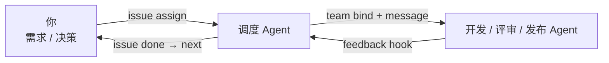

# CrewMoor

CrewMoor 是一个轻量级 CLI，用于在 Herdr TUI 中协调一组 AI Agent 完成开发任务：分配需求、传递消息、记录反馈、跟踪交付。



## 子命令

| 子命令 | 职责 |
|---|---|
| `crewmoor team` | 启动团队、绑定 worker，跟踪会话 |
| `crewmoor message` | 在调度与 worker 之间传递消息 |
| `crewmoor feedback` | 记录 Hook 事件，转交调度 |
| `crewmoor issue` | 分配 GitHub Issue，查询完成状态，取下一项 |

## 快速上手

> **前提**：已安装 `herdr`、`gh`（已登录），Herdr TUI 正在运行。

### 1. 安装

```bash
cargo install --path .
```

### 2. 注册 Hook 回调

```bash
crewmoor feedback install
```

安装后，Agent 的 Stop / SessionEnd 等事件会自动记录并转交调度。

### 3. 启动团队

```bash
# 在已有 pane 中启动角色，绑定 worker 到调度
crewmoor team start  --team myteam --config team.toml
crewmoor team bind   --team myteam --worker developer
crewmoor team stop   --team myteam
```

### 4. 分配和跟踪需求

```bash
# 把 Issue #42 分配给调度实例
crewmoor issue assign ~/.local/state/crewmoor/registry musutrade/crewmoor 42 <instance>

# 查看当前分配
crewmoor issue current ~/.local/state/crewmoor/registry <instance>

# 查询 Issue 是否已关闭
crewmoor issue done ~/.local/state/crewmoor/registry <instance>

# 取下一项可开发 Issue（默认 label=ready）
crewmoor issue next musutrade/crewmoor
crewmoor issue next musutrade/crewmoor --label sprint
```

### 5. 发送消息

```bash
crewmoor message send --binding roles/developer/binding.json \
  --from dispatcher --to developer \
  '{"task":"implement feature X"}'
```

### 6. 查看反馈记录

```bash
crewmoor feedback show <instance>
```

## 条件交付

调度 Agent Stop 时，CrewMoor 自动检查：

1. 当前分配的 Issue 是否已 closed
2. 队列中是否有下一项（label=ready）

若两者都满足，自动通过消息协议把下一项发给调度，一次，不重复。

## 质量门禁

CRAP ≤ 10，非测试代码无 `unwrap()`，零 Clippy 豁免。

```bash
cargo +stable run --locked --manifest-path tools/quality/Cargo.toml -- verify
```

详见 [docs/quality-gates.md](docs/quality-gates.md)。
