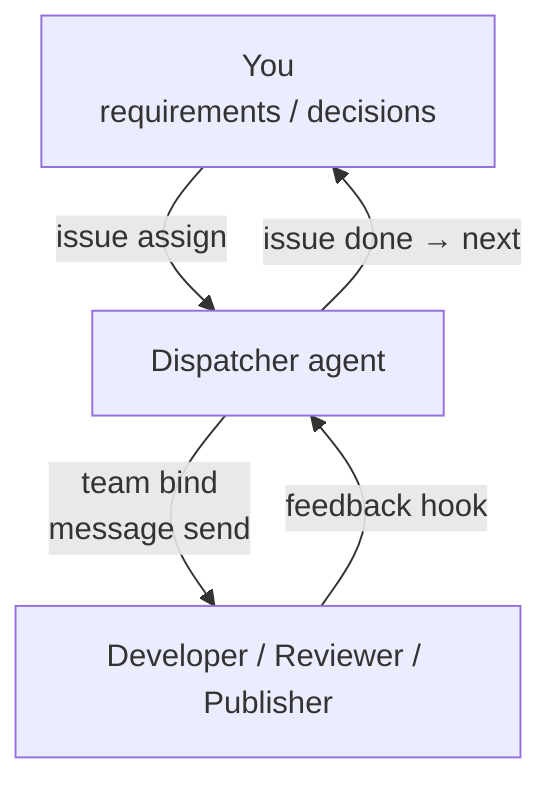

# CrewMoor

A lightweight CLI for coordinating AI agents across runtimes: assign requirements, pass messages, record feedback, and track delivery.

Currently supports **Herdr TUI**. Herdr App and Orca support planned.

[中文说明](docs/README.zh.md)



## Runtime support

| Runtime | Status |
|---|---|
| Herdr TUI | Supported |
| Herdr App | Planned |
| Orca | Planned |

A team runs in one runtime instance. Different teams may use different runtimes.

## Subcommands

| Command | Responsibility |
|---|---|
| `crewmoor team` | Start a team, bind workers, track sessions |
| `crewmoor message` | Send messages between dispatcher and workers |
| `crewmoor feedback` | Record Hook events and forward to dispatcher |
| `crewmoor issue` | Assign a GitHub Issue, check completion, fetch next |

## Quick start

> **Prerequisites**: `herdr` and `gh` (authenticated) installed, Herdr TUI running.

### 1. Install

```bash
cargo install --path .
```

### 2. Register the Hook callback

```bash
crewmoor feedback install
```

After installation, Stop / SessionEnd events from agents are recorded and forwarded to the dispatcher automatically.

### 3. Start a team

```bash
crewmoor team start --team myteam --config team.toml
crewmoor team bind  --team myteam --worker developer
crewmoor team stop  --team myteam
```

### 4. Assign and track a requirement

```bash
# Assign Issue #42 to the dispatcher instance
crewmoor issue assign ~/.local/state/crewmoor/registry musutrade/crewmoor 42 <instance>

# Read current assignment
crewmoor issue current ~/.local/state/crewmoor/registry <instance>

# Check whether the issue is closed
crewmoor issue done ~/.local/state/crewmoor/registry <instance>

# Fetch the next open issue (default label: ready)
crewmoor issue next musutrade/crewmoor
crewmoor issue next musutrade/crewmoor --label sprint
```

### 5. Send a message

```bash
crewmoor message send --binding roles/developer/binding.json \
  --from dispatcher --to developer \
  '{"task":"implement feature X"}'
```

### 6. View feedback records

```bash
crewmoor feedback show <instance>
```

## Conditional delivery

When the dispatcher agent stops, CrewMoor checks automatically:

1. Is the currently assigned issue closed?
2. Is there a next open issue in the queue (label=ready)?

If both are true, the next issue is sent to the dispatcher once, without resending.

## Quality gates

CRAP ≤ 10, no `unwrap()` in non-test code, zero Clippy exemptions.

```bash
cargo +stable run --locked --manifest-path tools/quality/Cargo.toml -- verify
```

See [docs/quality-gates.md](docs/quality-gates.md) for details.
