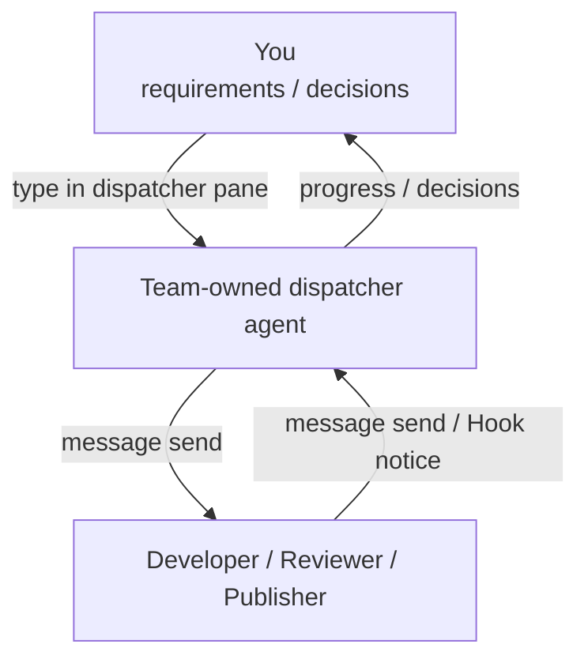

# CrewMoor

A lightweight CLI for coordinating AI agents across runtimes: assign requirements, pass messages, record feedback, and track delivery.

Supports **Herdr TUI** and **Herdr App** (via herdr-core). Orca support planned.

[中文说明](docs/README.zh.md)



## Runtime support

| Runtime | Status |
|---|---|
| Herdr TUI | Supported |
| Herdr App (herdr-core) | Supported |
| Orca | Planned |

A team runs in one runtime instance. Different teams may use different runtimes.

The user works directly in the dispatcher pane created by `team start`. That
dispatcher assigns work and reports results through the fixed worker bindings;
there is one dispatch layer. The launcher hands over the returned team directory
and dispatcher location, then leaves ongoing coordination to that dispatcher.
Existing sessions are not imported into this workflow.

## Subcommands

| Command | Responsibility |
|---|---|
| `crewmoor team` | Generate factual config, start a team, bind workers, track sessions |
| `crewmoor message` | Send messages between dispatcher and workers |
| `crewmoor feedback` | Record Hook events and forward to dispatcher |
| `crewmoor issue` | Assign a GitHub Issue, check completion, fetch next |
| `crewmoor app-target` | Generate an `app-target.toml` from a running herdr-core |

## Quick start

> **Prerequisites**: `gh` (authenticated) for manual GitHub issue commands, plus one of:
> - **Herdr TUI**: `herdr` running
> - **Herdr App**: `hc` (herdr-core) running and connected to Herdr App; an `app-target.toml` pointing at the live socket

### 1. Install

```bash
cargo install --path .
```

### 2. Register the Hook callback

```bash
crewmoor feedback hooks plan claude install REGISTRY BINARY PLAN_DIR
crewmoor feedback hooks apply PLAN_DIR
```

Repeat for each Agent kind used (`claude` or `codex`), preserving existing
handlers and completing any native Hook review. Only registered task instances
are collected; worker Stop / SessionEnd forwarding starts after `team bind`.
See [Hook installation](docs/agent-feedback.md) and the versioned
[crewmoor-team-flow skill](skills/crewmoor-team-flow/SKILL.md).

### 3. Start a team

**Herdr TUI** (`runtime = "tui"`, team config includes `host`):

```bash
crewmoor team generate /absolute/team-template.toml --output /absolute/team.toml
crewmoor team start /absolute/team.toml /absolute/state
# Use the returned team_dir; sample-team/worker are from examples/team-tui.toml.
crewmoor team bind /absolute/state/teams/sample-team worker
```

**Herdr App / herdr-core** (`runtime = "core"`, team config includes `app_target`):

```bash
crewmoor team generate /absolute/core-template.toml --output /absolute/team-core.toml
crewmoor team start /absolute/team-core.toml /absolute/state
crewmoor team bind /absolute/state/teams/sample-core-team worker
```

See [`examples/team-core.toml`](examples/team-core.toml) for a core-mode team config template.

Generation reads current executable/version/server facts and preserves task and
role choices from your template. Start with the [TUI](examples/team-generate-tui.toml)
or [core](examples/team-generate-core.toml) generation template. TUI requires an
explicit existing server socket; core requires an existing app-target profile.
Stdout is TOML when `--output` is omitted; a named output must be new. Generation
starts no Agent or service. Core client/server version mismatches are rejected by
the present launch contract; TUI client/server versions remain separate.

Read `roles[]` in the start result: select the role named by the configuration's
`dispatcher`, and open its returned `handle` (TUI pane or core terminal). Enter
requirements and decisions there in ordinary language; the human needs no
separate role or self-binding. The launcher supplies `team_dir`, CLI path and
worker binding paths to that dispatcher. Bind each worker after both native
associations exist: SessionStart for Codex/Claude, API-created main session for
[OpenCode v2](docs/opencode.md). OpenCode messages target that fixed session even
while its UI browses another one. If a session or binding
is missing, report it once; do not poll, re-launch or adopt another session.
`accepted` is launch admission, not Agent readiness or task completion.
See the [complete handover chain](docs/team-launch.md).

### 4. Assign and track a requirement

```bash
# Assign Issue #42 to the dispatcher instance
crewmoor issue assign ~/.local/state/crewmoor/feedback musutrade/crewmoor 42 <instance>

# Read current assignment
crewmoor issue current ~/.local/state/crewmoor/feedback <instance>

# Check whether the issue is closed
crewmoor issue done ~/.local/state/crewmoor/feedback <instance>

# Fetch the next open issue (default label: ready)
crewmoor issue next musutrade/crewmoor
crewmoor issue next musutrade/crewmoor --label sprint
```

### 5. Send a message

```bash
# Reuse the pair binding written by team bind; do not bind the pair again.
crewmoor message send /absolute/state/teams/sample-team/roles/worker/binding.json /absolute/request.json
```

The dispatcher authors a flat request such as
`{"id":"request-001","from":"lead","to":"worker","reply_to":null,"content":"Implement the assigned requirement and report the result."}`.
The worker actively replies through the same binding with a new `id`, reversed
roles and `reply_to: "request-001"`. `reply_to` refers to the original message
ID, not a role name. `transport: accepted` means submission only; the authored
reply establishes actual receipt and business progress. Direct `herdr agent
prompt` or `hc send` is the transport implementation, not another business
channel for team members. See [message semantics](docs/messages.md).

### 6. View feedback records

```bash
crewmoor feedback show ~/.local/state/crewmoor/feedback <instance>
```

When the team's work is finished, close only its recorded resources:

```bash
crewmoor team stop /absolute/state/teams/sample-team
```

## Herdr App / herdr-core

For `runtime = "core"` teams, CrewMoor connects to an already-running herdr-core instance through an **app-target file**.

### Generate app-target.toml

```bash
# Print to stdout (review before saving)
crewmoor app-target generate

# Write directly to a file (refuses to overwrite an existing one)
crewmoor app-target generate --output app-target.toml

# Point at a non-default socket
crewmoor app-target generate --socket /run/user/1000/herdr-core/other.sock --output app-target.toml
```

The command reads `server.status` and `doc.get` from the live socket. It fills in `session`, `socket`, `core_id`, and `machine` automatically. Available spaces and tabs are listed as commented-out lines so you can uncomment the one you want; both fields are omitted by default (project placement mode).

Example output:

```toml
# Generated by crewmoor app-target generate (hc 0.1.16)
# Review space_id and tab_id before use; omit both for project placement.
session   = "default"
socket    = "/run/user/1000/herdr-core/default.sock"
core_id   = "4a8f843e64e0a7778943d8a31c25cc26"
machine   = "musutrade"

# Available spaces and tabs (uncomment to use):
# space: myproject
# space_id = "sp-abc"  # myproject
# tab_id   = "tb-def"  # main
```

Once you have the file, point your team config at it:

```toml
# team.toml
app_target = "/path/to/app-target.toml"
```

CrewMoor reads this file, verifies the running core identity, and routes all terminal sends through the existing socket. It never starts or stops the core process.

### One App tab per role

By default every role's terminal gets the `herdr.space` / `herdr.tab` labels from `app-target.toml`, so all roles share one tab. To give a role its own tab, set `tab_id` on that role in `team.toml`. Roles without `tab_id` keep using the `app-target.toml` tab.

```toml
[[roles]]
role = "lead"
tab_id = "tb-lead-tab-id"    # overrides app-target.toml tab_id for this role
# ...

[[roles]]
role = "worker"
tab_id = "tb-worker-tab-id"
# ...
```

Rules:

- Only `runtime = "core"` teams accept a per-role `tab_id`.
- `app-target.toml` must set both `space_id` and `tab_id`; per-role tabs live in that space. Project placement (both omitted) does not support per-role tabs.
- The selected explicit space must already exist. Both a role's `tab_id` and the target file's `tab_id` may be existing or new. An exact configured `<machine>/` prefix is accepted and stripped; other prefixes and invalid IDs are rejected.

CrewMoor passes these IDs as native adoption labels. The connected App creates a new unnamed tab when needed; no tab precreation is required. A mistyped but valid tab ID creates an extra tab. After owned terminals end, the App removes empty new tabs. CrewMoor does not write the App layout or delete user tabs/spaces. With both target IDs omitted, project placement keeps its existing behavior.

## Session integrity

Roles may set optional `initial_prompt` with user-supplied or explicitly authorized initialization text. Codex/Claude receive one literal interactive positional prompt; OpenCode receives native `--prompt` on its API-created fixed main session. This occurs on the new role's native launch before binding; generate, bind and Hooks do not replay it. Omit the field for the existing behavior. CrewMoor currently requires nonblank text, at most 4096 UTF-8 bytes, no control characters (including newlines), and no leading `-`; these are CrewMoor restrictions. Configuration snapshots and startup argv retain the body: do not include passwords, API keys or tokens. Submission, actual receipt, guard invocation and configuration effect require separate evidence; see [initialization and failure handling](docs/team-launch.md#optional-initialization-with-initial_prompt).

CrewMoor records each agent's native session at bind time. For Codex/Claude this comes from the Agent's Hook; a different Hook session records `session-rejected` and refuses normal sends while preserving the binding. Report the change once, without automatic rebind, restart or recovery. Rejected worker Hooks may forward one halt notice per event, with no transport deduplication; dispatcher events stay local. OpenCode instead pins its API-created main session and private endpoint: browsing UI B still sends to bound A, while a missing or changed real endpoint/session association is refused. View facts with `feedback show`; a turn ending is not business completion.

## No daemon

There is no background process or state machine. Hook callbacks record native events
and forward bound worker notices; they do not query GitHub or dispatch requirements.

## Automatic continuation paused

The Stop Hook no longer checks issue completion, selects the next issue or delivers
it to the dispatcher. Automatic continuation through this Hook path is paused until
a replacement is agreed in [#51](https://github.com/musutrade/crewmoor/issues/51).
No replacement trigger or background mechanism is implemented.

Manual `issue assign/current/done/next` commands remain available to the business
Agent. Stop is a turn notice, not business completion. The remaining worker-forward
timeout budget work in [#45](https://github.com/musutrade/crewmoor/issues/45) is
separate; this removal does not resolve that budget mismatch.

## Quality gates

CRAP ≤ 10, no `unwrap()` in non-test code, zero Clippy exemptions.

```bash
cargo +stable run --locked --manifest-path tools/quality/Cargo.toml -- verify
```

See [docs/quality-gates.md](docs/quality-gates.md) for details.
