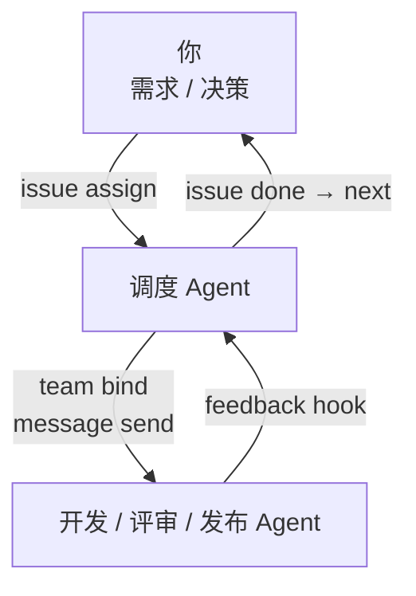

# CrewMoor

一个轻量级 CLI，用于跨容器协调 AI Agent 完成开发任务：分配需求、传递消息、记录反馈、跟踪交付。

当前支持 **Herdr TUI** 和 **Herdr App**（通过 herdr-core），未来计划支持 Orca。

[English](../README.md)



## 容器兼容性

| 容器 | 状态 |
|---|---|
| Herdr TUI | 已支持 |
| Herdr App（herdr-core） | 已支持 |
| Orca | 计划中 |

一个团队运行在一个容器实例中，不同团队可使用不同容器。

## 子命令

| 子命令 | 职责 |
|---|---|
| `crewmoor team` | 启动团队、绑定 worker，跟踪会话 |
| `crewmoor message` | 在调度与 worker 之间传递消息 |
| `crewmoor feedback` | 记录 Hook 事件，转交调度 |
| `crewmoor issue` | 分配 GitHub Issue，查询完成状态，取下一项 |

## 快速上手

> **前提**：已安装 `gh`（已登录），以及以下之一：
> - **Herdr TUI**：`herdr` 正在运行
> - **Herdr App**：`hc`（herdr-core）正在运行并已连接 Herdr App；准备好指向活跃 socket 的 `app-target.toml`

### 1. 安装

```bash
cargo install --path .
```

### 2. 注册 Hook 回调

```bash
crewmoor feedback hooks plan claude install REGISTRY BINARY PLAN_DIR
crewmoor feedback hooks apply PLAN_DIR
```

安装后，Agent 的 Stop / SessionEnd 等事件会自动记录并转交调度。

### 3. 启动团队

**Herdr TUI**（`runtime = "tui"`，配置含 `host`）：

```bash
crewmoor team start team.toml ~/.local/state/crewmoor
crewmoor team bind  ~/.local/state/crewmoor/teams/myteam developer
crewmoor team stop  ~/.local/state/crewmoor/teams/myteam
```

**Herdr App / herdr-core**（`runtime = "core"`，配置含 `app_target`）：

```bash
crewmoor team start team-core.toml ~/.local/state/crewmoor
crewmoor team bind  ~/.local/state/crewmoor/teams/myteam developer
crewmoor team stop  ~/.local/state/crewmoor/teams/myteam
```

配置模板见 [`examples/team-core.toml`](../examples/team-core.toml)。

### 4. 分配和跟踪需求

```bash
# 把 Issue #42 分配给调度实例
crewmoor issue assign ~/.local/state/crewmoor/registry musutrade/crewmoor 42 <instance>

# 查看当前分配
crewmoor issue current ~/.local/state/crewmoor/registry <instance>

# 查询 Issue 是否已关闭
crewmoor issue done ~/.local/state/crewmoor/registry <instance>

# 取下一项可开发 Issue（默认 label=ready）
crewmoor issue next musutrade/crewmoor
crewmoor issue next musutrade/crewmoor --label sprint
```

### 5. 发送消息

```bash
# 先 bind（生成 binding 文件）
crewmoor message bind msg-config.json roles/developer/binding.json

# 再 send
crewmoor message send roles/developer/binding.json message.json
```

### 6. 查看反馈记录

```bash
crewmoor feedback show ~/.local/state/crewmoor/feedback <instance>
```

## Herdr App / herdr-core

`runtime = "core"` 的团队通过 **app-target 文件**连接已运行的 herdr-core 实例：

```toml
# app-target.toml
session   = "my-session"
socket    = "/run/user/1000/herdr-core/default.sock"
core_id   = "<hc server status 中的 id>"
machine   = "<机器名>"
space_id  = "<Herdr App 中的 space id>"   # 可选；省略则使用 project placement
tab_id    = "<Herdr App 中的 tab id>"     # 与 space_id 同时省略或同时填写
```

CrewMoor 读取该文件、核对运行中的 core 身份，并通过已有 socket 完成所有终端发送，不启动也不停止 core 进程。

## 会话完整性

CrewMoor 在绑定时记录每个 Agent 的 session ID（来自 Agent 自己的 Hook，不由进程状态推断）。session 发生变化时——Agent 重启、重新登录或上下文重置——团队立即停止并写入可见的拒绝记录，不会静默继续。

## 无后台进程

没有常驻进程，也没有状态机。条件交付完全在 Hook 回调内完成（2 秒窗口）。交付失败会写入 unconfirmed 记录，下次 Stop 自动重试。调用未能启动时不写标记，下次直接重试。

## 条件交付

调度 Agent Stop 时，CrewMoor 自动检查：

1. 当前分配的 Issue 是否已 closed
2. 队列中是否有下一项（label=ready）

若两者都满足，自动通过消息协议把下一项发给调度，一次，不重复。

## 质量门禁

CRAP ≤ 10，非测试代码无 `unwrap()`，零 Clippy 豁免。

```bash
cargo +stable run --locked --manifest-path tools/quality/Cargo.toml -- verify
```

详见 [quality-gates.md](quality-gates.md)。
