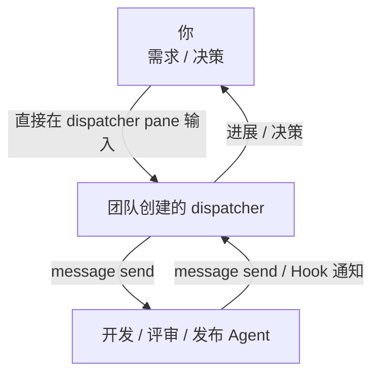

# CrewMoor

一个轻量级 CLI，用于跨容器协调 AI Agent 完成开发任务：分配需求、传递消息、记录反馈、跟踪交付。

当前支持 **Herdr TUI** 和 **Herdr App**（通过 herdr-core），未来计划支持 Orca。

[English](../README.md)



## 容器兼容性

| 容器 | 状态 |
|---|---|
| Herdr TUI | 已支持 |
| Herdr App（herdr-core） | 已支持 |
| Orca | 计划中 |

一个团队运行在一个容器实例中，不同团队可使用不同容器。

用户直接面对 `team start` 创建的 dispatcher，在它的 pane 中下达需求和决策。
dispatcher 使用固定 worker binding 派工并接收回报，只设这一层调度。
启动方交出返回的团队目录和 dispatcher 位置后，由 dispatcher 继续协调；
不把用户既有会话收养进团队。

## 子命令

| 子命令 | 职责 |
|---|---|
| `crewmoor team` | 发现配置事实、启动团队、绑定 worker，跟踪会话 |
| `crewmoor message` | 在调度与 worker 之间传递消息 |
| `crewmoor feedback` | 记录 Hook 事件，转交调度 |
| `crewmoor issue` | 分配 GitHub Issue，查询完成状态，取下一项 |

## 快速上手

> **前提**：已安装 `gh`（已登录），以及以下之一：
> - **Herdr TUI**：`herdr` 正在运行
> - **Herdr App**：`hc`（herdr-core）正在运行并已连接 Herdr App；准备好指向活跃 socket 的 `app-target.toml`

### 1. 安装

```bash
cargo install --path .
```

### 2. 注册 Hook 回调

```bash
crewmoor feedback hooks plan claude install REGISTRY BINARY PLAN_DIR
crewmoor feedback hooks apply PLAN_DIR
```

对团队使用的每种 Agent（`claude` / `codex`）分别安装，保留其他处理器并完成原生
Hook 审阅。仅收集已注册的任务实例；`team bind` 后，worker 的 Stop / SessionEnd
才会自动转发给 dispatcher。详见 [Hook 安装](agent-feedback.md) 和版本化的
[crewmoor-team-flow 技能](../skills/crewmoor-team-flow/SKILL.md)。

### 3. 启动团队

**Herdr TUI**（`runtime = "tui"`，配置含 `host`）：

```bash
crewmoor team generate /absolute/team-template.toml --output /absolute/team.toml
crewmoor team start /absolute/team.toml /absolute/state
# 使用返回的 team_dir；sample-team/worker 对应 examples/team-tui.toml。
crewmoor team bind /absolute/state/teams/sample-team worker
```

**Herdr App / herdr-core**（`runtime = "core"`，配置含 `app_target`）：

```bash
crewmoor team generate /absolute/core-template.toml --output /absolute/team-core.toml
crewmoor team start /absolute/team-core.toml /absolute/state
crewmoor team bind /absolute/state/teams/sample-core-team worker
```

配置模板见 [`examples/team-core.toml`](../examples/team-core.toml)。

生成器读取实际可执行路径、版本及服务端事实，保留模板中的任务、角色、cwd、参数和
prompt。生成模板见 [TUI](../examples/team-generate-tui.toml) 和
[core](../examples/team-generate-core.toml)。TUI 必须明确选择已有 server socket；
core 必须引用已有 app-target，不创建隐藏 sidecar。不传 `--output` 时 stdout 仅为
可审阅 TOML，指定输出必须是新文件；生成过程不启动 Agent 或服务。TUI 客户端与
服务端版本分别记录；当前 core 启动/绑定合同不支持版本不一致，生成时明确拒绝。
详见 [生成字段和校验语义](team-launch.md#generate-factual-fields-from-the-existing-environment)。

从启动结果的 `roles[]` 中找到配置 `dispatcher` 指定的角色，打开它返回的 `handle`
（TUI pane 或 core terminal），直接用自然语言输入任务。用户不需要另注册角色或
建立自发自收 binding。启动方把 `team_dir`、CLI 路径和 worker binding 路径交给
dispatcher。两端原生 SessionStart 建立 session 后，逐一绑定 worker；缺少 session
或 binding 时只报告一次，不轮询、重复启动或收养会话。启动请求 `accepted` 不代表
Agent ready 或业务完成。完整链路见 [团队启动与交接](team-launch.md)。

### 4. 分配和跟踪需求

```bash
# 把 Issue #42 分配给调度实例
crewmoor issue assign ~/.local/state/crewmoor/feedback musutrade/crewmoor 42 <instance>

# 查看当前分配
crewmoor issue current ~/.local/state/crewmoor/feedback <instance>

# 查询 Issue 是否已关闭
crewmoor issue done ~/.local/state/crewmoor/feedback <instance>

# 取下一项可开发 Issue（默认 label=ready）
crewmoor issue next musutrade/crewmoor
crewmoor issue next musutrade/crewmoor --label sprint
```

### 5. 发送消息

```bash
# 复用 team bind 生成的固定 binding，不重复绑定。
crewmoor message send /absolute/state/teams/sample-team/roles/worker/binding.json /absolute/request.json
```

dispatcher 创建平铺请求，例如
`{"id":"request-001","from":"lead","to":"worker","reply_to":null,"content":"实现已分配需求并主动回报结果。"}`。
worker 用同一 binding 主动回复：新 `id`、交换 `from` / `to`，
`reply_to: "request-001"`。`reply_to` 指原请求消息 ID，不是角色名。
`transport: accepted` 仅代表提交受理；主动回复才证明实际收件和业务进展。
团队成员不把底层 `herdr agent prompt` / `hc send` 当作另一条业务通信通道。
详见 [消息语义](messages.md)。

### 6. 查看反馈记录

```bash
crewmoor feedback show ~/.local/state/crewmoor/feedback <instance>
```

业务结束后，仅清理团队记录的自有资源：

```bash
crewmoor team stop /absolute/state/teams/sample-team
```

## Herdr App / herdr-core

`runtime = "core"` 的团队通过 **app-target 文件**连接已运行的 herdr-core 实例：

```toml
# app-target.toml
session   = "my-session"
socket    = "/run/user/1000/herdr-core/default.sock"
core_id   = "<hc server status 中的 id>"
machine   = "<机器名>"
space_id  = "<Herdr App 中的 space id>"   # 可选；省略则使用 project placement
tab_id    = "<Herdr App 中的 tab id>"     # 与 space_id 同时省略或同时填写
```

CrewMoor 读取该文件、核对运行中的 core 身份，并通过已有 socket 完成所有终端发送，不启动也不停止 core 进程。

## 会话完整性

CrewMoor 在绑定时记录每个 Agent 的 session ID（来自 Agent 自己的 Hook，不由进程状态推断）。不同原生 session 会留下可见的 `session-rejected` 事实；后续涉及该 dispatcher 或 worker 的普通发送均拒绝，保留原 binding 和关联。立即停止向该角色派工并报告用户，不自动 rebind、重启或恢复。worker 每条被拒的 Hook 事件都可能向未变更的 dispatcher 转发一条 halt 通知；多条拒收事件可产生多条通知，传输层不去重，由 dispatcher 向用户报告一次 halt；dispatcher 自己的事件保留在本地，因为用户已经直接面对它，不另设上游 Agent。两端事实均可用 `feedback show` 查看；轮次结束不等于业务完成。

## 无后台进程

没有常驻进程，也没有状态机。条件交付在有时间界限的 Hook 回调内执行；
提交前即被拒绝的交付可在后续 Stop 再考虑，已受理或结果不明的提交留有标记，不重复发送。

## 条件交付

调度 Agent Stop 时，CrewMoor 自动检查：

1. 当前分配的 Issue 是否已 closed
2. 队列中是否有下一项（label=ready）

若两者都满足，自动通过消息协议把下一项发给调度，一次，不重复。

## 质量门禁

CRAP ≤ 10，非测试代码无 `unwrap()`，零 Clippy 豁免。

```bash
cargo +stable run --locked --manifest-path tools/quality/Cargo.toml -- verify
```

详见 [quality-gates.md](quality-gates.md)。
